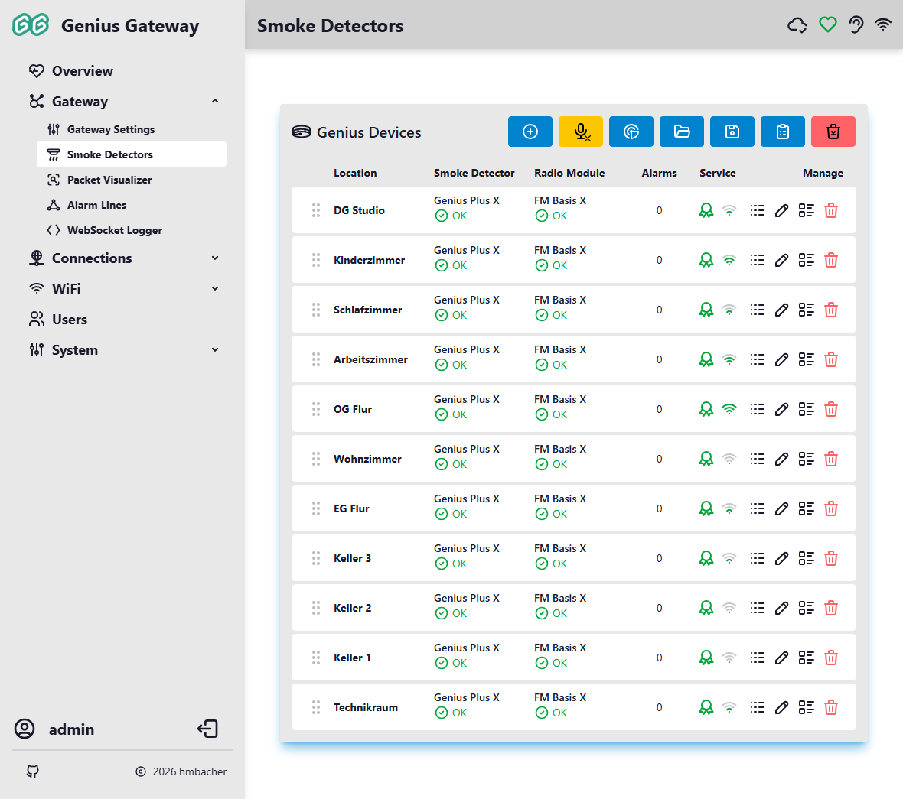
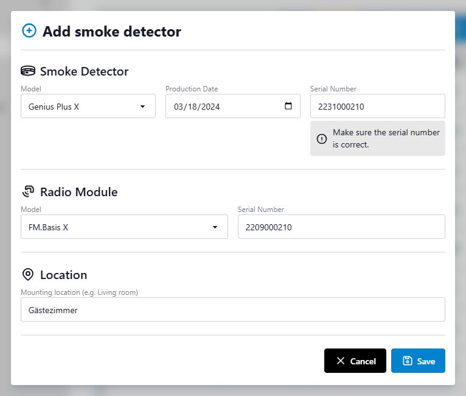
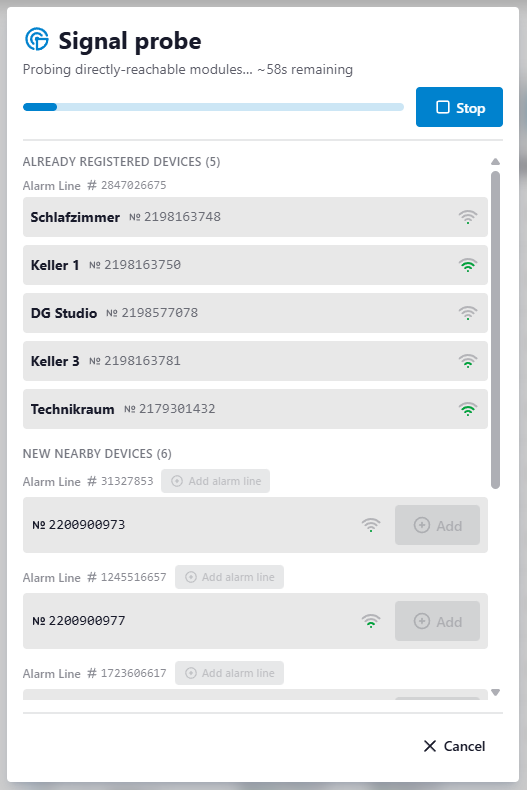
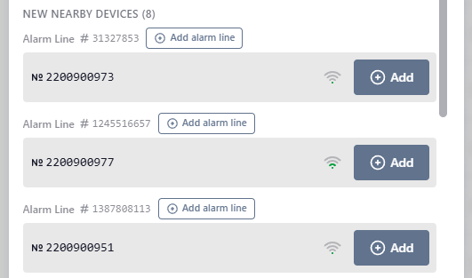
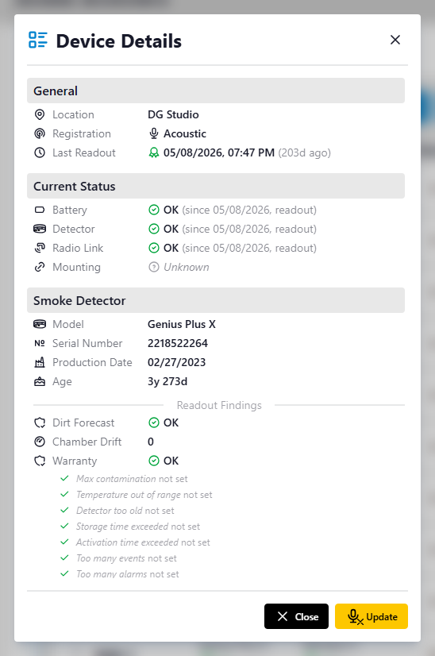
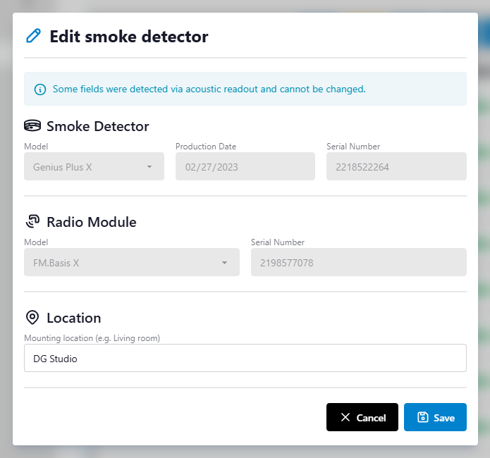

# Device Management

The Device Management page provides a centralized interface for configuring and monitoring all Genius smoke detector devices connected to your gateway. This page allows you to add, edit, and delete smoke detectors, view their alarm history, organize them through drag-and-drop, and manage device configurations via export/import functionality.

<!-- TODO: retake screenshot – trash-x delete-all button (btn-error, rightmost in toolbar) added to the actions area -->

!!! info "Access Requirements"
    Device Management is only accessible to users with administrator privileges. The gateway must be connected to at least one Genius smoke detector to display device information.

## Device List Overview

The device list displays all registered Genius smoke detectors in a structured table format with the following columns:

#### Location
The assigned location name for each detector (e.g., "Living Room", "Bedroom"). If no location has been assigned, the device shows "Unknown location" in italicized gray text.

#### Smoke Detector
Model name and status of the smoke detector component:

- **Model**: The smoke detector model (e.g., "Genius Plus X"), or "Unknown model" in italics if not yet identified
- **Status**: The [current status](#current-status) - :tabler-circle-check:{ style="color: #4caf50" } **OK** if no faults, :tabler-alert-circle:{ style="color: #f44336" } **Fault** with fault details in tooltip (e.g. battery low), or "Status not available" if the gateway has neither received a status from the smoke detector nor performed a readout. The status indicator is greyed out if the last readout is more than one year old.

#### Radio Module
Model name and status of the radio communication module:

- **No radio module**: shown if the device has no radio module or serial number
- **Model**: The radio module model (e.g., "FM Basis X"), or "Unknown model" in italics
- **Status**: Same as smoke detector status - :tabler-circle-check:{ style="color: #4caf50" } OK / :tabler-alert-circle:{ style="color: #f44336" } Fault (radio link fault) / not available

#### Alarms
Alarm statistics for the device:

- **Count**: Total number of recorded alarms
- **Last Alarm**: Date of the most recent alarm event (displayed if any alarms exist)

#### Service
Acoustic readout status icon:

- :tabler-award:{ style="color: #4caf50" } - Readout performed and up to date (within the last year)
- :tabler-calendar-exclamation:{ style="color: #f44336" } - Last readout is more than 1 year ago
- :tabler-microphone-off:{ style="color: #f44336" } - No acoustic readout performed yet

When the device has a radio module, a :tabler-wifi: signal-strength icon also appears here, showing its direct-link quality from the last [Signal Probe Discovery](#signal-probe-discovery).

#### Manage
Action buttons for device operations:

- :tabler-logs: **Alarm Log**: Open the [activity log](#viewing-the-activity-log), filtered to alarms (only visible if alarms exist)
- :tabler-list-details: **Device Details**: View full readout data and trigger a new acoustic readout
- :tabler-pencil: **Edit**: Modify device configuration
- :tabler-trash: **Delete**: Remove device from the system

## Initial Setup

When you first access the Device Management page with no smoke detectors configured, you'll see a helpful message:

> **No smoke detectors configured yet.**
>
> Click the "+" button to add your first smoke detector.

You can proceed to [add a new smoke detector](#adding-a-new-detector) by either:

1. **Manual Registration**: Explicitly add smoke detectors you've configured (recommended for planned installations)
2. **Automatic Discovery**: Enable automatic device registration in [Gateway Settings](gateway-settings.md#process-alerts-from-unknown-smoke-detectors), then trigger any smoke detector-the gateway will automatically register the device when it receives an alarm packet

## Reordering Devices

You can change the display order of devices using drag-and-drop functionality:

1. Click and hold the grip icon (:tabler-grip-horizontal:) on the left side of any device row
2. Drag the device to the desired position in the list
3. Release to drop the device in its new position
4. The new order is automatically saved to the gateway

This feature is useful for organizing devices by floor level, room priority, or any custom arrangement that suits your needs.

## Viewing the Activity Log

For each smoke detector the gateway keeps an activity log - one chronology of what it recorded about the detector. To view it:

1. Click the :tabler-logs: **Alarm Log** button in the device's row (only visible if alarms exist), or click an alarming card on the [Overview](overview.md)
2. The Activity Log dialog opens with the switch **Alarms only** on. Switch it off to see every entry, newest first:

    | Entry | Meaning |
    |-------|---------|
    | :tabler-circle-plus: **Smoke detector added** | The detector was added to the gateway, and how |
    | :tabler-microphone: **Acoustic readout** | A readout was performed, with the faults it reported |
    | :tabler-access-point: **Status change received** | The detector announced a fault, or that a fault is gone, over the air |
    | :tabler-restore: **Status reset** | The reported faults were [discarded](#resetting-the-status) in the gateway |
    | :tabler-bell-ringing: **Alarm** | An alarm, with its start and - once it ended - its end and how it ended: no more smoke detected, stopped by a user in the web interface, or cleared during a device configuration import |

The log keeps the newest 50 entries per detector. The number of alarms is counted separately, so the alarm count in the device list stays correct when old alarms drop out of the log; the dialog says so when that is the case. An entry made before the gateway's clock was set shows *Time unknown*.

## Adding a New Detector

### Manually adding a new Detector

To register a new Genius smoke detector:

1. Click the :tabler-circle-plus: **Add smoke detector** button in the top-right corner
2. The "Add smoke detector" dialog opens with empty fields

    

3. Fill in the required information as follows:

    ***Location***  
    Enter a descriptive name for the detector's location (1-40 characters). This helps identify the device in the list and alarm notifications.

    If the Home Assistant option [*Update entity IDs when a detector's location changes*](../setup/connections.md#home-assistant-integration) is enabled, changing the location of an existing detector renames its entities in Home Assistant. A warning below the field points this out before you save, and a progress dialog follows the rename afterwards.

    ***Smoke Detector Component***

    - **Model**: Select the smoke detector model (currently *Genius Plus X*)
    - **Serial Number**: Enter the unique serial number (`1 - 4294967294`)
    - **Production Date**: Select the manufacturing date from the date picker

    ***Radio Module Component***

    - **Model**: Select the radio module model (currently *FM Basis X*)
    - **Serial Number**: Enter the unique serial number (`1 - 4294967294`)
    - **Production Date**: Select the manufacturing date from the date picker

4. Click :tabler-device-floppy: **Save** to add the device

The system validates all inputs and prevents duplicate serial numbers for both smoke detectors and radio modules.

### Automatic Device Discovery

In addition to manually adding devices, the Genius Gateway can automatically discover and register smoke detectors when they trigger an alarm. This feature requires the "Process alerts from unknown smoke detectors" setting to be enabled in [Gateway Settings](gateway-settings.md#process-alerts-from-unknown-smoke-detectors).

#### How Automatic Discovery Works

When an unknown smoke detector triggers an alarm:

1. The gateway receives the alarm packet containing the detector's serial number and radio module serial number
2. If automatic discovery is enabled, the gateway creates a new device entry with:
    - Smoke detector serial number from the alarm packet
    - Radio module serial number from the alarm packet
    - Location set to "Unknown location"
    - Model type set to "Unknown" for both components
    - Production dates unset (shown as "Unknown")
    - Registration type marked as :tabler-access-point: **Automatic**
3. The alarm is immediately processed and displayed in the system
4. MQTT notifications are published for the new device (if MQTT is enabled)

!!! note "Only alarms register devices"
    A battery warning or fault report from an unknown smoke detector does not register it - the [current status](#current-status) is only tracked for detectors already in the device list. Add the detector manually (or via acoustic readout) to receive its battery and fault status.

#### Updating Automatically Discovered Devices

Automatically discovered devices appear in the device list with "Unknown location" and can be edited like any other device (see [Editing a Detector](#editing-a-detector)). When editing these devices:

- **Location**: Replace "Unknown location" with a descriptive name for proper alarm identification
- **Model Types**: Will be automatically set to the default models (Genius Plus X and FM Basis X) when opening the edit dialog
- **Production Dates**: Add the actual manufacturing dates if known
- **Serial Numbers**: Verify the automatically captured values are correct (if possible)

!!! tip "Best Practice"
    Review and update automatically discovered devices promptly to ensure proper identification during future alarms. A descriptive location name is especially important for alarm notifications.

!!! info "Device Registration Type"
    The registration type indicator (:tabler-forms: Manual vs :tabler-access-point: Automatic) shows how each device was originally added and persists even after editing the device details.

### Adding via Acoustic Readout

The gateway can register a new smoke detector by capturing its acoustic (SmartSonic) readout directly in the browser. All device identity fields - serial numbers, model, and production date - are read from the signal automatically.

!!! warning "HTTPS required"
    The browser's microphone API is only available over a secure (HTTPS) connection. The button is shown in warning color and disabled on plain HTTP.

To add a device via acoustic readout:

1. Click the :tabler-microphone: **Add smoke detector via acoustic detection** button in the top-right corner
2. The Acoustic Device Detection dialog opens and begins listening
3. Hold a phone or laptop microphone near the smoke detector and trigger its acoustic readout (refer to the detector's manual for how to initiate the tone)
4. Once the signal is captured and decoded, one of the following outcomes occurs based on whether the detected serial numbers are already known:

    | Situation | Outcome |
    |-----------|---------|
    | Both serial numbers are new | Add dialog opens pre-filled - enter a location and save |
    | Smoke detector SN already exists | Confirmation to update that device's readout data (location and alarm history preserved) |
    | Radio module SN already assigned to a different device | Confirmation to replace that device (alarm history of the previous device is lost) |
    | Each SN belongs to a different existing device | Confirmation to delete both conflicting devices and create a new combined entry |

5. After confirming, the device record is saved with registration type :tabler-microphone: **Acoustic**

Fields that were read from the acoustic signal (model, serial number, production date) are locked and cannot be changed after saving. Only the **Location** name needs to be entered manually.

!!! info "Acoustic readout signal details"
    See [Acoustic Readout](../reverse-engineering/acoustic-readout.md) in the Reverse Engineering section for a description of the signal modulation, framing, and payload format.

## Signal Probe Discovery

The gateway can actively **survey which radio modules are within direct radio range** and how strong their link is - and register any new ones it finds. It broadcasts a [ConfigCheckProbe](../reverse-engineering/protocol-analysis.md#configcheckprobe) direct-range reachability probe that every directly reachable module answers once, reporting its radio-module serial number, alarm line ID, and signal strength (RSSI). The probe is **not relayed** through the mesh, so only modules the gateway hears *directly* respond.

!!! tip "What it is useful for"
    Installation and diagnostics: check which module is directly reachable, compare signal strength across the property, and discover modules in direct range that are not yet registered - including neighbouring installations on other alarm lines.

### Running a survey

1. Click the :tabler-radar: **Discover directly reachable detectors** button in the top-right toolbar
2. A **Signal probe** progress dialog opens and fills in live as modules answer. The whole survey takes about a minute
3. Responders are grouped as they arrive:
    - **Known devices** - modules already in your device list; their signal strength and range-test timestamp get recorded
    - **New nearby** - modules that answered but are not yet registered (discovered devices)
4. While the survey is running, you can:
    - :tabler-player-stop: **Stop probing** - finish early but keep everything heard so far
    - **Cancel** - abort and discard the survey
5. After the survey finishes (or after stopping it) you can:  
    
    

    - :tabler-circle-plus: **Add** a *new nearby* module as a device - opens the [Adding a New Detector](#adding-a-new-detector) dialog pre-filled with the radio-module serial number
    - :tabler-circle-plus: **Add alarm line** for a line ID that showed up but is not configured yet - opens the [Adding a New Alarm Line](./alarm-lines-management.md#adding-a-new-alarm-line) dialog with the ID locked and its acquisition source set to :tabler-radar: *SignalProbe*

6. On completion a summary notification reports how many modules responded, how many known devices were updated, and how many new nearby modules were found; the device list refreshes so the new readings appear

### Signal strength indicator

Each device with a radio module shows a signal icon in the **Service** column reflecting its last range test:

| Icon | State | Meaning |
|------|-------|---------|
| :tabler-wifi:{ style="color: #4caf50" } (0-3 bars) | **Reached** | Heard directly. Bars and tooltip show quality (with the exact dBm and test date): <ul><li>Excellent (≥ -60 dBm)</li><li>Good (≥ -70 dBm)</li><li>Fair (≥ -80 dBm)</li><li>Weak (below)</li></ul> |
| :tabler-wifi-off: | **Out of range** | Included in a survey but did not answer directly |
| :tabler-radar-off: | **Not tested** | Never included in a range test yet |

The measured signal and last range-test date also appear in the [Device Details](#viewing-device-details) dialog and in the [PDF report](#generating-a-pdf-report) (Direct Link / Range Test section).

!!! info "Probe protocol details"
    See [ConfigCheckProbe](../reverse-engineering/protocol-analysis.md#configcheckprobe) in the Reverse Engineering section for the on-air request/response framing and repetition behaviour.

## Viewing Device Details

Click the :tabler-list-details: **Device Details** button in a device's row to open the Device Details dialog. It consolidates all available information about a detector in one place.

- **General** - location, registration type, and last acoustic readout timestamp. If a readout exists, the age is shown alongside the date (e.g. `15.03.2026 10:00 (37d ago)`). A :tabler-award:{ style="color: #4caf50" } icon indicates a recent readout; :tabler-calendar-exclamation:{ style="color: #f44336" } indicates a stale one (> 1 year).
- **Current Status** - battery, detector fault, radio link and mounting, each **OK**, active, or **Unknown**, plus the time of the last change and a **Reset Status** button - see [Current Status](#current-status).
- **Smoke Detector** - model, serial number, production date and age, and (after readout) the diagnostic status *at the last readout*: detector fault, battery, dirt forecast, chamber drift, warranty flags with individual flag breakdown, plus lifetime statistics (last self-test, last alarm, alarm counts, deinstallation count, storage hours).
- **Radio Module** - model, serial number, and (after readout) radio status with individual state flags, interference level, alarm line ID and character, and DIP switch configuration.

The dialog also provides an **Update** button (:tabler-microphone:) to trigger a new acoustic readout for that device directly, without leaving the dialog.

The same dialog opens when a detector card is clicked on the [Overview](overview.md#device-status-grid). There it has no **Update** button; administrators get an **Edit** button (:tabler-pencil:) instead, which switches to the [edit dialog](#editing-a-detector).

!!! info "Acoustic readout internals"
    For a detailed description of the signal modulation, framing, and the full payload field reference, see [Acoustic Readout](../reverse-engineering/acoustic-readout.md) in the Reverse Engineering section.

## Current Status

Besides alarms, smoke detectors announce changes of their **status flags** over the air: a **low battery**, a **device fault**, a **radio link fault** and the **dismounting** of the detector from its base (see [Status Change packet](../reverse-engineering/protocol-analysis.md#status-change)). The gateway keeps the current state of each flag per detector and shows it in the device list, the Device Details dialog and the [Overview](overview.md), publishes it to [Home Assistant](smart-home-integration.md#smoke-detectors) and optionally to a [fault topic](../setup/connections.md#simple-alarm-publishing). A new fault also pops up as a notification in the web interface, naming the detector and the fault.

There is one current status, fed by two sources - whichever is newest wins, per flag:

- **Received over the air** - the flag is set or cleared as announced by the smoke detector.
- **Acoustic readout** - a readout reports battery, detector fault and radio fault (the dismount flag is only ever announced over the air; old FM Basis / FM Pro modules report no radio status in a readout).

The Device Details dialog shows for every flag whether it is active, OK or unknown, since when, and from which source. Every change is recorded in the [activity log](#viewing-the-activity-log).

!!! info "Unknown until reported"
    Smoke detectors announce a flag only when it **changes** - never periodically. Until the gateway has received a flag (or performed a readout), its state is shown as **Unknown** rather than OK: a gateway that was put into operation after a battery warning was sent cannot know about it.

    For the same reason the status survives a restart of the gateway.

When a smoke detector is replaced - its serial number changes on the same entry - status, activity log and alarm counter start over by themselves.

### Resetting the status

A reported fault stays active until the smoke detector reports that it is gone or an acoustic readout shows it. If neither happens although the fault has been fixed, discard it manually:

1. Open the :tabler-list-details: **Device Details** dialog of the detector
2. Click :tabler-restore: **Reset Status** in the *Current Status* section (admins only, only shown while a fault is active)
3. Confirm the dialog

All active flags of the detector become **Unknown** - not OK. The status builds up again from what the detector reports over the air and from the next readout. The reset is recorded in the activity log.

!!! warning "Known limits of the status tracking"
    The status is based on a protocol that is only partly understood:

    - Smoke detectors announce a status change **once**. If the gateway misses it (restart, update, out of range), it does not learn about it.
    - So far only the battery warning, the radio link fault and its muting have been observed on air. The other flags and the "fault gone" message have not been observed on air yet.
    - A radio link fault is, as far as known, never cleared over the air - not even after the alarm line has been commissioned again.

    A fault shown here may therefore already be fixed, and **Unknown** does not mean OK. An acoustic readout is the reliable way to confirm battery, detector fault and radio link. The behaviour described here may change in future versions as more is learned about the protocol.

## Editing a Detector

To modify an existing detector's configuration:

1. Click the :tabler-pencil: **Edit smoke detector** button in the device's row
2. The "Edit smoke detector" dialog opens with the current device information

    

3. Modify any fields as needed:
    - Location name
    - Smoke detector serial number or production date (only if device has been added manually)
    - Radio module serial number or production date (only if device has been added manually)
4. Click :tabler-device-floppy: **Save** to apply changes

!!! tip "Unique Serial Numbers"
    The system ensures that modified serial numbers remain unique across all devices.

## Deleting a Detector

To remove a detector from the system:

1. Click the :tabler-trash: **Delete smoke detector** button in the device's row
2. A confirmation dialog appears showing the device's serial number and location
3. Click **Yes** to confirm deletion, or **Abort** to cancel

!!! warning "Deletion is Permanent"
    Deleting a device removes all associated data including alarm history. This action cannot be undone. Consider exporting your configuration before deleting devices.

## Deleting All Detectors

To remove every smoke detector from the system in one operation:

1. Click the :tabler-trash-x: **Delete all smoke detectors** button in the top-right corner
2. A confirmation dialog appears stating the number of detectors that will be deleted and that all alarm history will be lost
3. Click **Delete all** to confirm, or **Cancel** to abort

!!! danger "Export a backup first"
    Deleting all devices removes every device and its complete alarm history in a single, irreversible operation. Export your configuration using the :tabler-device-floppy: save button before proceeding.

The button is disabled and cannot be clicked when no devices are configured.

## Exporting Configuration

You can export your complete device configuration to a JSON file:

1. Click the :tabler-device-floppy: **Save smoke detector configuration to file** button in the top-right corner
2. Rename and save the file to the desired location

The export includes all device information and alarm history. This feature is useful for:

- Creating backups before making configuration changes
- Migrating device configurations to a new gateway
- Archiving alarm history for documentation purposes

## Importing Configuration

!!! warning "Import Replaces All Devices"
    Importing a configuration file completely replaces your current device list. Export your current configuration before importing if you want to preserve it.

You can import a previously exported device configuration:

1. Click the :tabler-folder-open: **Load smoke detector configuration from file** button in the top-right corner
2. Select a valid configuration file from your computer
3. The system validates the file format and migrates it if needed (older backup formats are automatically upgraded)
4. If any device in the file is marked as alarming, a dialog asks how to handle the alarm state:
    - **Keep Alarm State** - imports as-is; connected integrations (e.g. Home Assistant) may trigger automations (useful for testing)
    - **Clear Alarm State** - resets the alarm flag on all affected devices and closes open alarm log entries with a `Cleared by import` ending reason
5. If the import changes the location of detectors the gateway already knows, and their Home Assistant entity IDs follow the location, a dialog lists the changes and asks before importing - the entities of these detectors are renamed, so automations, scripts and dashboards that use the old entity IDs must be updated
6. A progress dialog shows the import status. For larger files the upload is split into chunks automatically and may take several seconds - a progress bar shows how many chunks have been sent. Wait for the *Finalizing* step to complete before navigating away
7. All existing devices are replaced with the imported configuration once the gateway confirms the commit

Home Assistant is brought in line in the background: detectors that are no longer in the list are removed, new ones are added, and changed ones are updated. Nothing is shown for this - unless the MQTT connection is down, in which case a notice explains that the gateway catches up on the next connect.

## Generating a PDF Report

Click the :tabler-file-type-pdf: **Generate PDF Report** button in the toolbar to produce a printable audit document. A progress dialog steps through fetching data and building the file; the PDF downloads automatically when complete.

The property name, address, and customer name printed on the cover page are configured in [Gateway Settings → Report Settings](gateway-settings.md#report-settings). Leaving those fields blank generates a report without a property header.

### Cover Page

- Gateway identification
- Property name, address, and customer name
- Generation timestamp
- Summary table of all registered smoke detectors (location, model, serial numbers, signal, number of alarms and the condition: *Alarm*, *Fault*, *OK*, or *Stale* / *No readout* when nothing current confirms that all is well)

### Per-Device Pages

One page per registered smoke detector:

- **Identity**: location, model, registration type, smoke detector and radio module serial numbers, production date and device age
- **Current status**: battery, detector, radio link and mounting as the gateway holds them at the time of the report - the same block as in the [Device Details](#current-status) dialog, with the date and the source (radio or readout) of each state. A state that was never reported is printed as *Unknown*
- **Readout findings** (only if an acoustic readout has been performed):
    - Smoke chamber: drift value, contamination forecast, warranty flags
    - Statistics: alarm count, last alarm date, last self-test date, deinstallation count, storage hours
- **Radio module**: line ID, direct link signal, the radio state flags of the last readout, interference level, DIP switch configuration
- **Activity log**: the same entries as in the [Activity Log](#viewing-the-activity-log) dialog, newest first - detector added, readouts, status changes received over the air, status resets and alarms with their end and duration

## Related Documentation

- [Gateway Settings](gateway-settings.md) - Configure alarming behavior, alarm line topology, and report header fields
- [MQTT Integration](../setup/connections.md#mqtt) - Monitor device status and alarms via MQTT
- [System Status](../setup/system.md) - View overall gateway health and connectivity