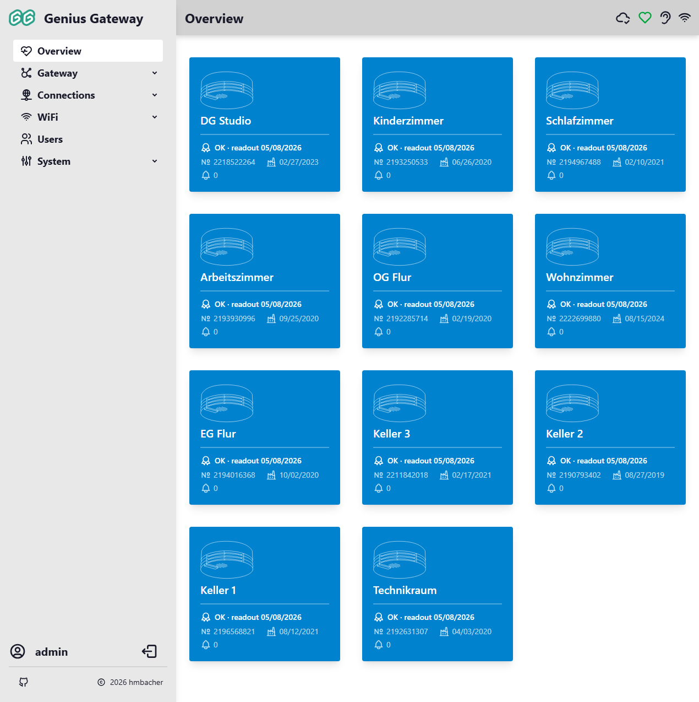
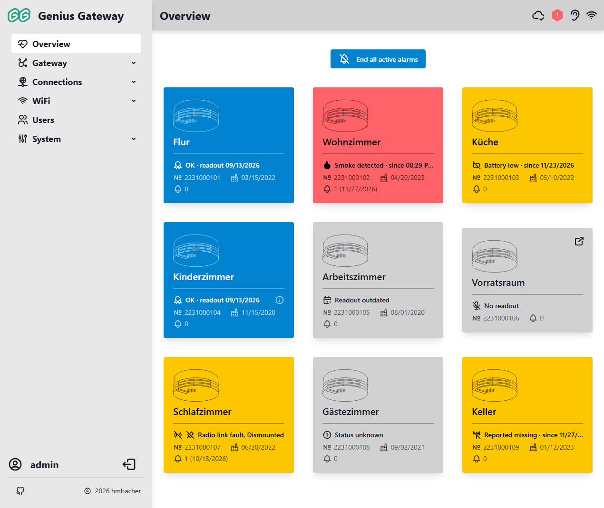
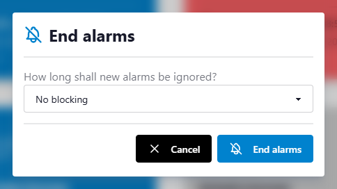
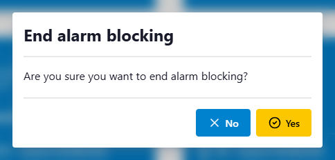

# Overview

The Overview page serves as the main dashboard of the Genius Gateway web interface, providing an at-a-glance view of all registered smoke detectors and their current status. This page is the default landing page after login and offers quick access to alarm management functions.

## Top-Bar Health Indicator

The health indicator icon in the navigation bar reflects the overall system state at a glance and links back to the Overview page from anywhere in the interface:

| Icon | Meaning |
|------|---------|
| :tabler-loader-2: | Connecting - device list not yet received |
| :tabler-heart-off: | No smoke detectors configured yet |
| :tabler-heart:{ style="color: #4caf50" } | All detectors OK - no fault reported and every detector has a current readout |
| :tabler-heart-question: | No fault reported, but the status of at least one detector is unknown (see [Unknown](#unknown) below) |
| :tabler-heart-exclamation:{ style="color: #ff9800" } | At least one detector reports a fault (see [Fault](#warning) below); the tooltip names how many |
| :tabler-alert-hexagon-filled:{ style="color: #f44336" } | At least one detector is actively alarming |

## Device Status Grid

The Overview page displays all registered smoke detectors in a responsive grid layout. Each card opens the clicked detector right on top of the Overview, without leaving the page:

- **Normal cards** open the **Device Details** dialog of that detector (no readout/set-line there). Administrators find an **Edit** button (:tabler-pencil:) in its footer that switches to the edit dialog; saving behaves exactly as on the Smoke Detectors page.
- **Alarming cards** open the **Activity Log** of that detector instead, filtered to alarms. Its **Details** button (:tabler-list-details:) leads on to Device Details.

Acoustic readout and changing the alarm line remain on the [Device Management](device-management.md) page. Users without administrator rights can open both dialogs, but are not offered the edit action.

When the smoke detectors are on more than one alarm line, the cards are shown in one group per line, under a heading with the name of the line, the number of its detectors and how many of them are alarming or have a fault. The grouping can be switched in the [smoke detector list](device-management.md#grouping-by-alarm-line).

### Card Conditions

Every card shows one of four conditions - the most important one that applies, in this order. The colour and a status line below the location name say which:

#### Alarm (Error theme color) {#alarming}

The smoke detector is alarming. The status line shows :tabler-flame-filled: *Smoke detected* and since when.

#### Fault (Warning theme color) {#warning}

The smoke detector reports at least one fault - its [current status](device-management.md#current-status), reported over the air or by the last readout. The status line shows one icon per fault and names the fault, for a single fault with its date:

| Icon | Fault |
|------|-------|
| :tabler-battery-off: | Battery low |
| *smoke detector, struck through* | Device fault |
| :tabler-access-point-off: | Radio link fault |
| :tabler-pinned-off: | Dismounted from its base |
| :tabler-antenna-off: | Radio module reported as missing by another detector |

#### OK (Primary theme color) {#healthy}

No fault is reported and an acoustic readout from within the last year confirms battery, detector and radio link. The status line shows :tabler-award: *OK* and the date of the readout.

#### Unknown (neutral grey) {#unknown}

No fault is reported, but nothing current confirms that all is well:

- :tabler-microphone-off: **No readout** - the device has never had an acoustic readout performed
- :tabler-calendar-exclamation: **Readout outdated** - the last acoustic readout is more than one year old
- :tabler-help-circle: **Status unknown** - the reported faults were [reset](device-management.md#resetting-the-status); the last readout no longer stands for them

Up to v1.5.0 these cards were yellow like a fault.

#### Hints

A :tabler-info-circle: icon at the end of the status line marks information that is no fault and does not change the colour - a fault muted on the detector, a status flag the gateway does not know yet, chamber drift, a negative dirt forecast or warranty flags from the last readout. The Device Details dialog has the particulars.

A :tabler-external-link: icon in the top-right corner marks a detector that was registered from a received packet, independent of its condition.

### Card Information

Each card displays:

- **Location** - the assigned location name
- :tabler-number: **Serial Number** - smoke detector unit identifier
- :tabler-building-factory-2: **Production Date** - manufacturing date (if available)
- :tabler-bell: **Alarm count and last alarm date** - total recorded alarms and date of the most recent event (if any)

### Foreign Detectors

A :tabler-external-link: icon marks cards for detectors from neighboring alarm lines that are received by the gateway but not part of your configured system.

!!! info "Foreign Detectors"
    To process alarms from foreign detectors, enable "Process alerts from unknown smoke detectors" in [Gateway Settings](gateway-settings.md#process-alerts-from-unknown-smoke-detectors).

## Alarm Management

When one or more smoke detectors are actively alarming, the Overview page displays an alarm management section at the top of the device grid.

### End All Active Alarms

The **End all active alarms** button (:tabler-bell-off:) becomes visible when any device is in alarm state.

{ .off-glb }

Clicking this button opens a dialog where you can:

{ .off-glb }

1. Specify an alarm blocking time (0-600 seconds)
2. Confirm the action to end all active alarms
3. Temporarily prevent new alarms during the blocking period

#### Alarm Blocking Counter

When an alarm blocking time is active, a countdown is displayed showing the remaining seconds:

You can press the counter button to immediately end the blocking period and resume normal alarm processing:

{ .off-glb }

A confirmation dialog will appear to verify the action:

{ .off-glb }

This feature is useful for:

- Silencing false alarms after investigation
- Stopping alarm propagation during testing
- Managing nuisance alarms while addressing the root cause

!!! warning "Alarm Blocking Time"
    Setting a blocking time prevents the gateway from processing new alarm signals during the specified period. Use this feature carefully to avoid missing genuine fire alerts.

## Empty State

If no smoke detectors are configured, the Overview page displays an informational message with a link to the [Device Management](device-management.md) page, guiding users to add their first devices.

## Related Documentation

- [Device Management](device-management.md) - Add, edit, and configure smoke detectors
- [Gateway Settings](gateway-settings.md) - Configure alarming behavior and system settings
- [Alarm Lines](alarm-lines-management.md) - Manage alarm line topology and foreign detector behavior
