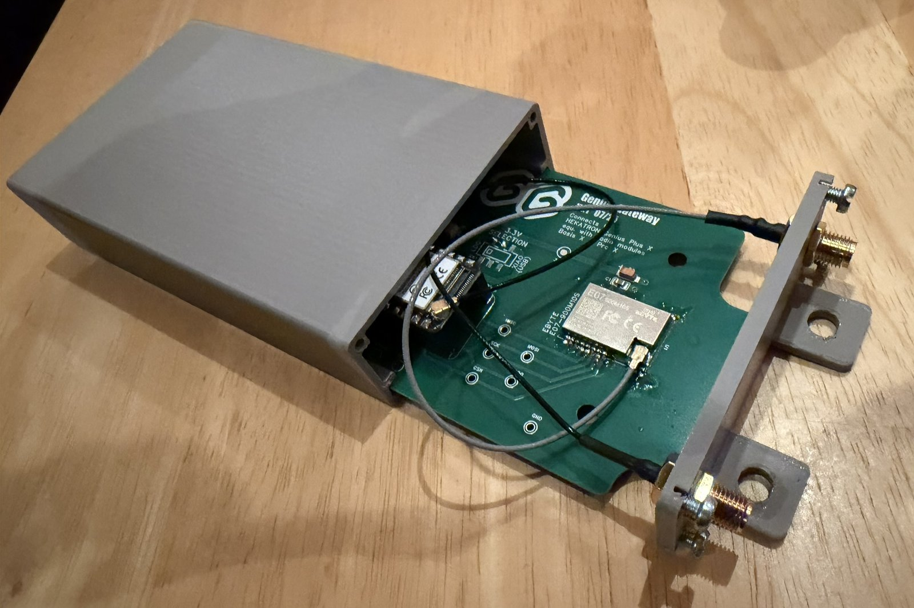
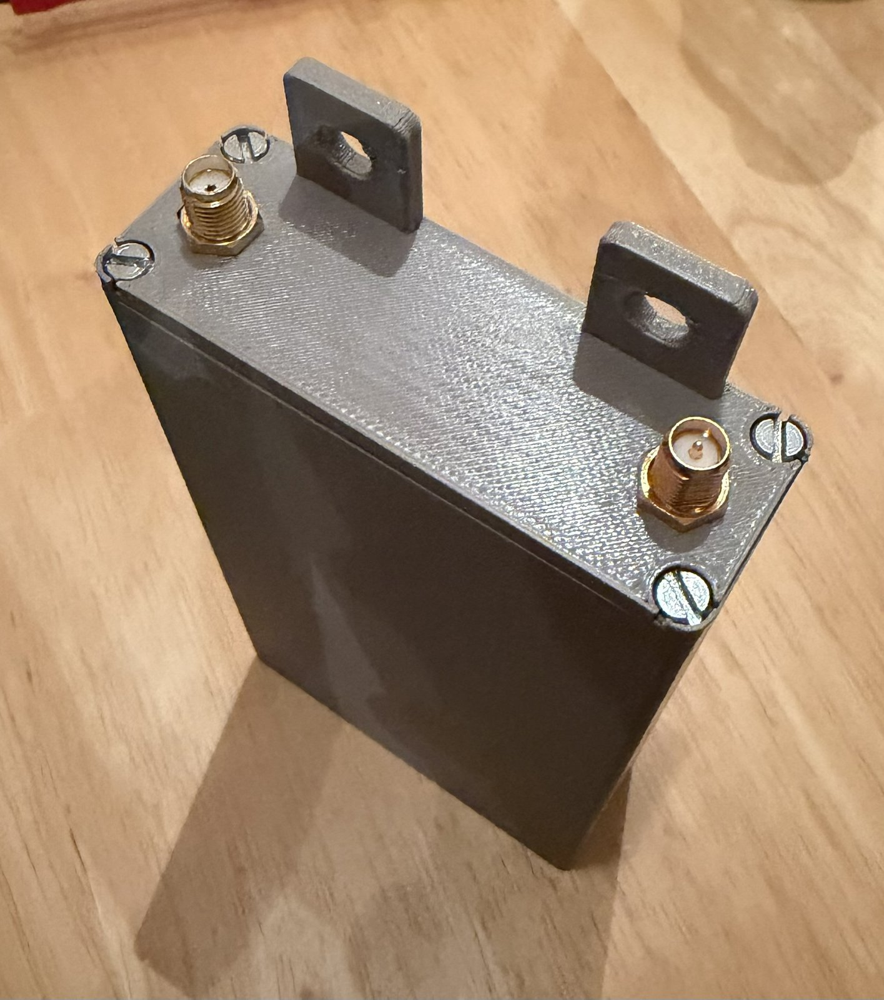
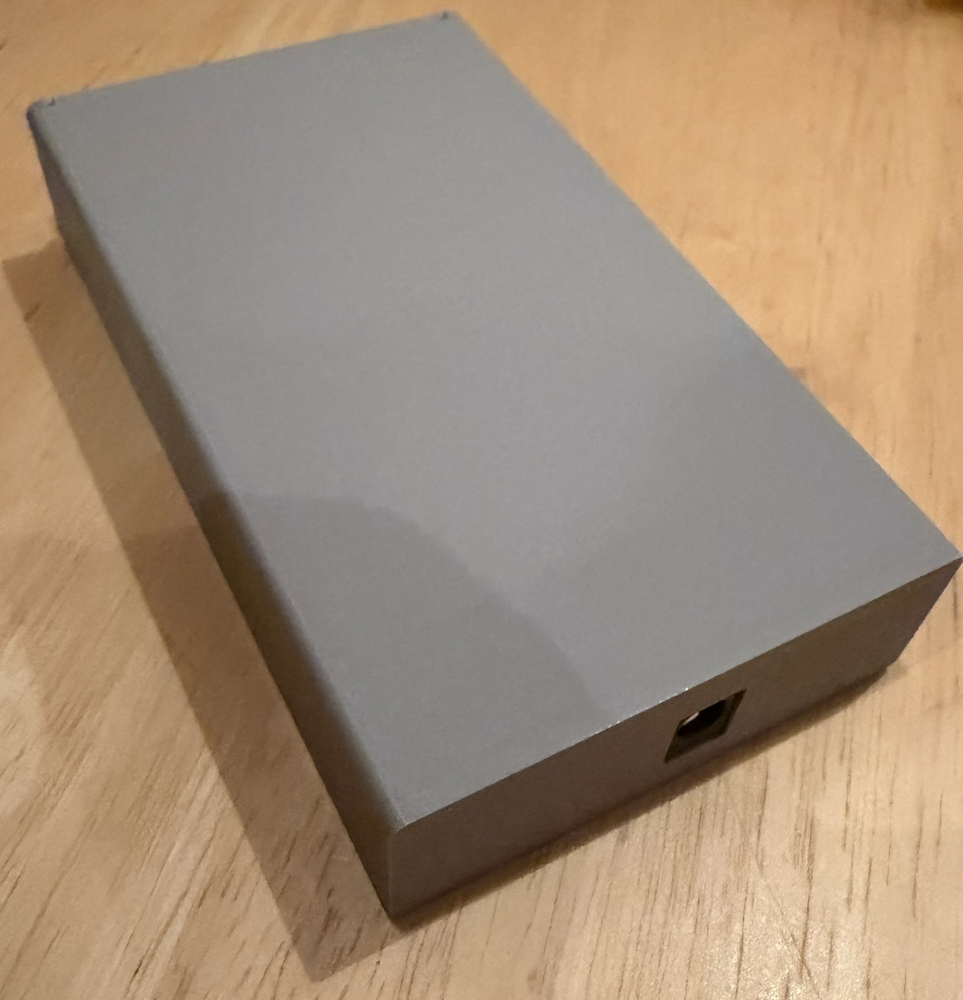

# Community

Hardware for the Genius Gateway, designed and shared by users of the project.

The designs on this page are provided by their designers. The project does not maintain them and has not built or checked them, unless an entry says so. They are published under the [hardware license](../license.md#hardware-design) and credited to their designers.

## Cases

3D-printable cases, as alternatives to the off-the-shelf enclosure listed in the [BOM](index.md#other-parts).

### Sleeve case by danielrdt

A two-part case. The PCB slides into grooves of a sleeve that is closed at one end; an end cap that carries the two antenna connectors closes the other end.

-   

    The PCB slides into the body, the antenna pigtail cables are mounted in the head

-   

    Head with the two SMA connectors and the mounting lugs

-   

    Closed end of the body with the opening for the DC jack

| Property | Details |
|----------|---------|
| **Designer** | [danielrdt :material-open-in-new:](https://github.com/danielrdt) |
| **Fits** | PCB v1.1 |
| **Parts** | 2 - body (sleeve, closed at one end) and head (end cap) |
| **Size** | approx. 71 x 25 x 138 mm, including the mounting lugs |
| **Fasteners** | 4 pcs. M3x6 screws for the head, screwed directly into the plastic |
| **Openings** | DC jack in the closed end of the body, two holes in the head for the SMA connectors of the antenna pigtail cables. No opening for the LED. |
| **Mounting** | Two lugs with a hole each on the head |
| **Print notes** | Printed by the designer on a Prusa MK4 in PETG with 0.2 mm layer height: the body upright, standing on its closed end, the head next to it. |
| **Status** | Printed and in use by the designer. |

| File | Size | Format | Comment |
|------|------|--------|---------|
| [:material-download: gg-sleeve-case-body.3mf](../assets/downloads/cad/community/cases/sleeve-case-danielrdt/gg-sleeve-case-body.3mf) | 12 KB | 3MF | Body |
| [:material-download: gg-sleeve-case-head.3mf](../assets/downloads/cad/community/cases/sleeve-case-danielrdt/gg-sleeve-case-head.3mf) | 23 KB | 3MF | Head |
| [:material-download: gg-sleeve-case-body.step](../assets/downloads/cad/community/cases/sleeve-case-danielrdt/gg-sleeve-case-body.step) | 54 KB | STEP (AP214) | Body |
| [:material-download: gg-sleeve-case-head.step](../assets/downloads/cad/community/cases/sleeve-case-danielrdt/gg-sleeve-case-head.step) | 51 KB | STEP (AP214) | Head |
| [:material-download: gg-sleeve-case.f3d](../assets/downloads/cad/community/cases/sleeve-case-danielrdt/gg-sleeve-case.f3d) | 379 KB | AUTODESK Fusion | Complete design |

The 3MF files hold the two parts in their assembled position; arrange them on the print bed in your slicer.

## Contribute your design

You designed a case, or something else for the gateway? Share it with a pull request or an issue on [GitHub :material-open-in-new:](https://github.com/hmbacher/genius-gateway). For a case, a contribution should contain:

- the printable files (3MF or STL) and a neutral CAD format such as STEP
- at least one photo of the printed case, without location data in the image file
- the PCB revision the case fits
- material, fasteners and print notes (orientation, supports, layer height)

Contributed designs are published under the [hardware license](../license.md#hardware-design) and credited to their designers.
