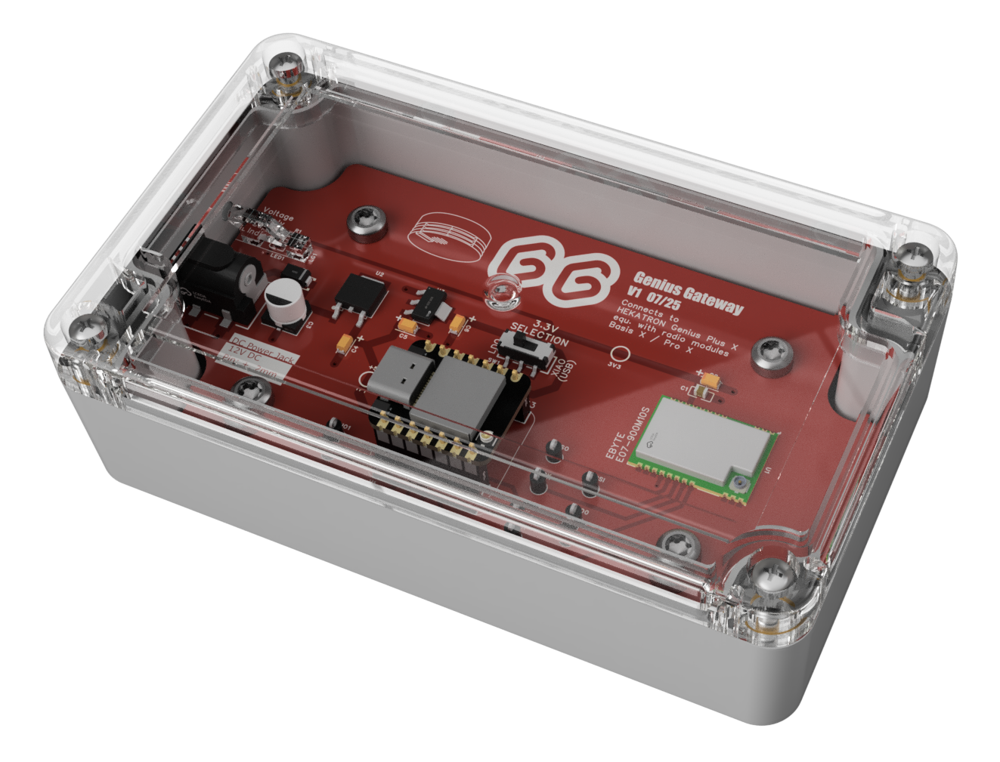

# Genius Gateway

!!! danger "IMPORTANT DISCLAIMER"
    This is a reverse-engineered implementation **NOT AFFILIATED** with Hekatron. 

    **You are solely responsible for ensuring compliance with all local regulations regarding RF communication and fire safety systems. The authors assume no liability for any damages or safety issues.**
    
    **USE AT YOUR OWN RISK!** 

## What is the Genius Gateway?

---

{ .off-glb }

---

The **Genius Gateway** is a reverse-engineered interface for [Hekatron Genius Plus X](background.md) smoke detection systems. It enables real-time monitoring, MQTT integration, and web-based management of Genius smoke detectors without requiring proprietary Hekatron gateways.

## Key Features

- :material-fire-alert: **Fire alarms in real time** - Every alarm of your smoke detectors, at once in the web interface, over MQTT and in Home Assistant
- :material-battery-alert: **Detector status and faults** - Low battery, device and radio faults and dismounting, reported over the air, with an activity log per detector
- :material-radio-tower: **Radio link supervision and range test** - Missing radio modules, last seen and signal strength (FM Pro X), and a range test that shows how well each detector is heard
- :material-smoke-detector: **Smoke detectors and alarm lines** - Acoustic readout, grouping by alarm line and a PDF report; start a line test, commissioning or a fire alarm for a line
- :simple-homeassistant: **Home Assistant integration** - Automatic discovery with entities for smoke detectors and alarm lines
- :material-api: **Open interfaces** - MQTT value tree and simple alarm and fault topics for other smart home systems, REST and WebSocket API
- :material-chart-line: **Packet visualizer** - Capture, decode and analyze the radio packets

## Getting Started

Get your Genius Gateway up and running:

1. Review the documentation structure to understand how information is organized
2. Perform the [General Setup](setup/general-setup.md)
3. [Configure Genius Gateway](setup/configure-gateway.md) to use its full potential

!!! tip "Hardware from the community"
    Users of the project share their own designs for the gateway, such as 3D-printable cases - see [Hardware - Community](hardware/community.md).

## Source Code

[View on GitHub :fontawesome-brands-github:{ .github }](https://github.com/hmbacher/genius-gateway){ .md-button .md-button--primary }
