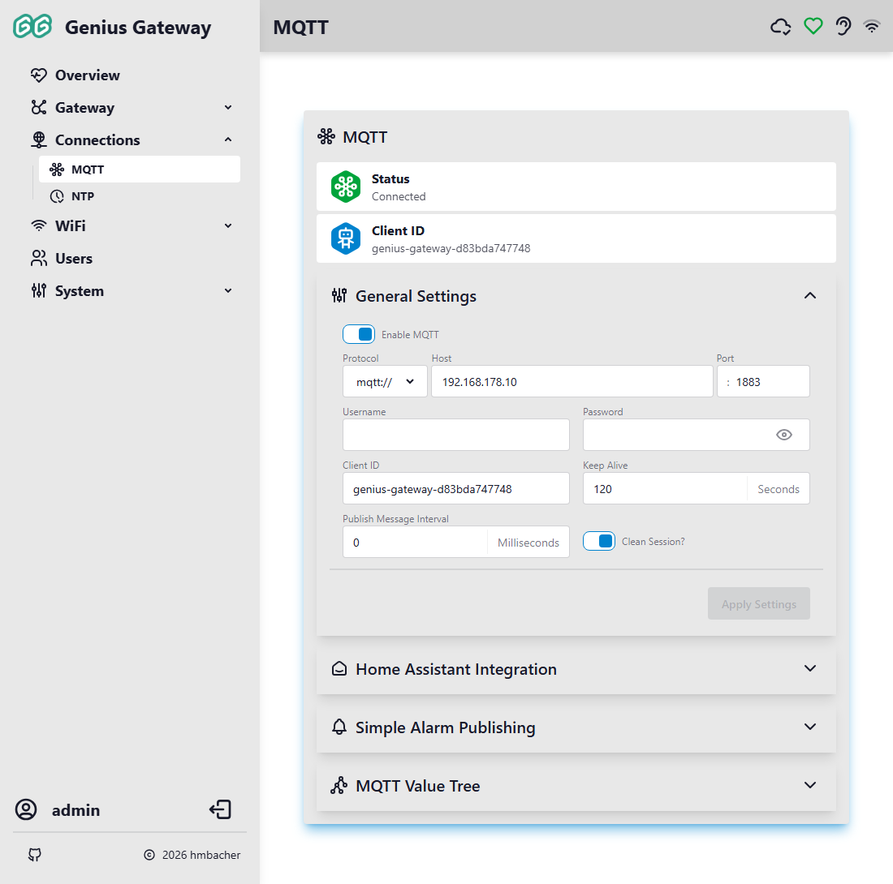
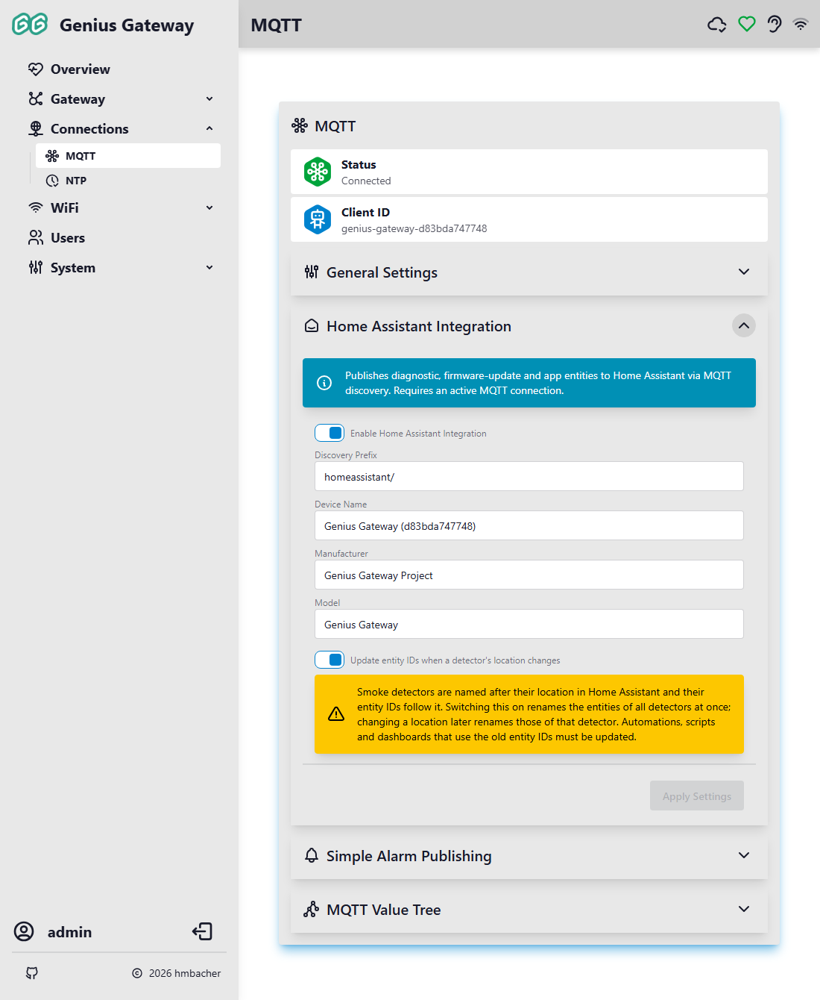
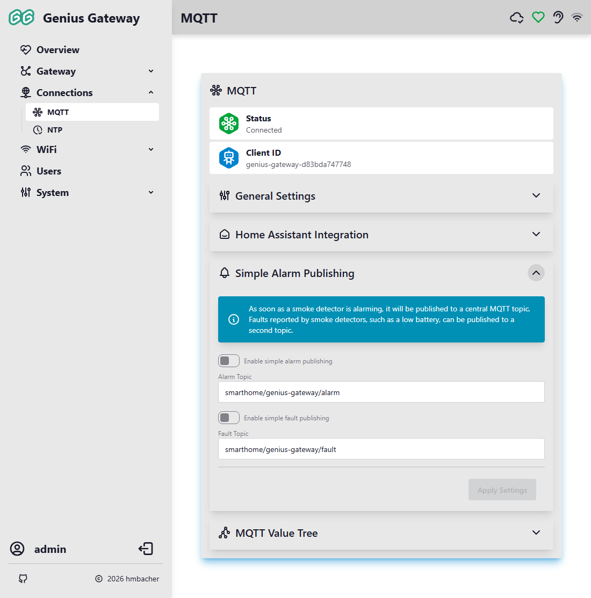
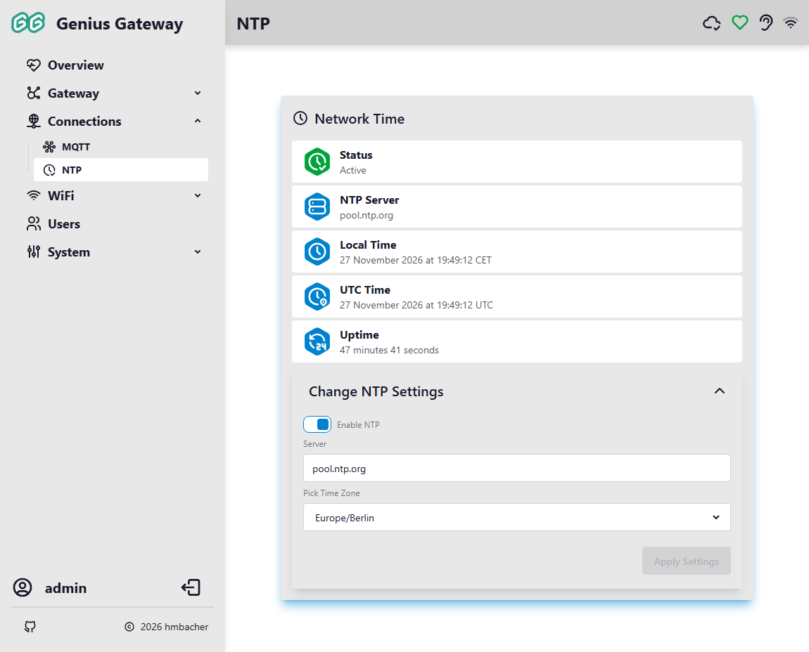

# Connections

The Connections pages configure external network services that the Genius Gateway can integrate with, including MQTT for smart home integration and NTP for accurate time synchronization.

## :tabler-topology-star-3: MQTT

MQTT (Message Queuing Telemetry Transport) is a lightweight messaging protocol ideal for IoT devices and smart home integration. The Genius Gateway can publish device states and alarm events to an MQTT broker for integration with home automation systems like Home Assistant.



### MQTT Status

The MQTT status section displays self-explaning real-time connection information.

### :tabler-adjustments-alt: General Settings

Click the **General Settings** collapsible section to configure MQTT connection parameters.

!!! info "Administrator Access Required"
    MQTT settings can only be modified by users with administrator privileges.

#### Connection Settings

**Enable MQTT**

Toggle to enable or disable MQTT functionality. When disabled, no MQTT connections or publishing occur.

**URI**

The MQTT broker URI is composed of three separate fields: a **Protocol** dropdown, a **Host** input (hostname or IPv4 address), and a **Port** input. The fields are validated independently and assembled into a `<protocol>://<host>:<port>` URI behind the scenes.

Supported protocols and their default ports:

- **`mqtt://`** - unencrypted MQTT over TCP, default port **1883**
- **`mqtts://`** - MQTT over TLS/SSL, default port **8883**
- **`ws://`** - MQTT over unencrypted WebSocket, default port **80**
- **`wss://`** - MQTT over WebSocket Secure (TLS), default port **443**

!!! tip "Automatic Port Updates"
    Switching the protocol updates the port field to the new protocol's default - but only if the current port still matches the previous protocol's default. Custom ports you have set are preserved across protocol changes.

**Username**

Optional username for MQTT broker authentication. Leave empty if the broker doesn't require authentication.

**Password**

Optional password for MQTT broker authentication. Leave empty if the broker doesn't require authentication.

!!! warning "Password Storage"
    Passwords are stored unencrypted in the device's file system. Ensure physical access to the device is restricted.

**Client ID**

Unique identifier for this MQTT client. Each device connecting to the same broker must have a unique client ID.

**Keep Alive**

MQTT keep-alive interval in seconds (1-600). The device sends a ping to the broker if no other messages are sent within this interval to maintain the connection.

**Publish Message Interval**

Minimum interval between published MQTT messages in milliseconds (0-1000).

!!! info "Disable Rate Limiting"
    0 = no rate limiting. Messages will be sent immediately.

This rate limiting may be used to prevent overwhelming the broker with rapid updates, if necessary.

**Clean Session**

When enabled, the broker discards all information about previous sessions when the client connects.

- **Enabled** (checked): Start with a clean slate, no retained messages or subscriptions
- **Disabled** (unchecked): Resume previous session with retained messages and subscriptions

!!! tip "Session Persistence"
    Genius Gateway does not rely on the MQTT broker's persistence function, as it publishes the state of all smoke detectors to the broker on every reconnect.

    It is therefore recommended to enable this feature to ensure a consistent state and stable connection at all times.

**Applying Changes**

Click **Apply Settings** to save and apply the MQTT configuration. The device will reconnect to the MQTT broker with the new settings.

### :tabler-smart-home: Home Assistant Integration {#home-assistant-integration}

The **Home Assistant Integration** collapsible card enables [MQTT Discovery :material-open-in-new:](https://www.home-assistant.io/integrations/mqtt/#mqtt-discovery){ target=_blank } and configures the gateway's device identity in Home Assistant.



!!! info "Administrator Access Required"
    Home Assistant settings can only be modified by users with administrator privileges.

**Enable Home Assistant Integration**

Toggle to enable/disable publishing with MQTT Discovery support for:

- Gateway device with diagnostic sensors and remote controls
- Individual detector configurations and states
- Alarm line controls (if configured)

!!! warning "Disabling removes the device from Home Assistant"
    When this toggle is turned off while MQTT is connected, the gateway immediately sends empty retained payloads to all discovery topics, causing Home Assistant to remove the gateway device and all its entities. Re-enabling will re-register everything on the next save.

**Discovery Prefix**

Home Assistant MQTT Discovery prefix. All device discovery messages will use this prefix followed by the component type (e.g., `binary_sensor`, `button`, `sensor`). Default: `homeassistant/`.

**Example:** Using the default prefix creates discovery topics like:

- `homeassistant/binary_sensor/genius-gateway-<id>/…/config` (smoke detector)
- `homeassistant/button/genius-gateway-<id>/…/config` (alarm line button)

!!! warning "Home Assistant compatibility"
    The prefix must match the `discovery_prefix` configured in your Home Assistant instance.

**Device Name**

Name shown in Home Assistant's device registry. The factory default is `Genius Gateway (<device MAC>)` (e.g. `Genius Gateway (1a2b3c4d5e6f)`), so multiple units on the same network are distinguishable without any manual configuration.

!!! tip "Renaming is safe"
    The Device Name is purely cosmetic - it only sets the label Home Assistant displays. MQTT topics and the gateway's identity in HA's device registry are derived from the firmware name and the device's MAC address, so renaming never moves topics, never orphans entities, and never creates a second device in Home Assistant.

    This was **not** the case up to v1.5.0, where renaming re-identified the gateway and left the previous device behind as a ghost. See the upgrade note below.

!!! warning "MQTT topics changed in v1.6.0"
    Firmware v1.6.0 restructured the Home Assistant topic tree. Base topics lost a redundant namespace level and no longer embed the MAC address twice:

    ```
    v1.5.0  homeassistant/genius-gateway-1a2b3c4d5e6f/genius-gateway-1a2b3c4d5e6f-1a2b3c4d5e6f/…
    v1.6.0  homeassistant/genius-gateway-1a2b3c4d5e6f/…
    ```

    **The upgrade cleans up after itself.** On the first MQTT connect after flashing v1.6.0, the gateway clears every retained discovery config and state message it previously published under the old tree - always retiring an old config immediately before publishing its replacement - so Home Assistant drops the stale entity before registering the new one.

    What this means for your setup:

    - **Smoke detectors and alarm lines are untouched.** Their discovery topics never contained the Device Name, and their `unique_id` is unchanged, so Home Assistant updates them in place. Entity IDs, history, and automations all survive.
    - **The gateway's own entities** (status, free heap, core temperature, restart button, the configuration switches, the firmware update entity) are re-registered under the new device identity. Because the old configs are cleared first, they reclaim their previous entity IDs, so automations referencing them keep working and recorder history - which is keyed by entity ID - is retained.

    Two things are worth checking afterwards:

    - **Home Assistant** :material-arrow-right: *Settings* :material-arrow-right: *Devices & Services* :material-arrow-right: *MQTT*: if a duplicate gateway device is still listed after a restart of Home Assistant, delete it manually.
    - **Your MQTT broker**: retained messages the gateway had published before, but no longer publishes at all (for example entities removed in an earlier firmware version), are not covered by the automatic cleanup. Browsing the broker with a tool like MQTT Explorer and deleting anything left under the old path removes the last remnants.

    The automatic cleanup runs on **every boot** as long as an old-style tree could exist, so a gateway that was offline during the upgrade still cleans up whenever it next connects.

**Manufacturer / Model**

Optional labels shown in the Home Assistant device info panel. Useful for multi-gateway deployments to distinguish individual units.

!!! tip "Build-time Model Customization"
    If `-D HW_VERSION=\"...\"` is set in the build flags, it is automatically appended to the model default (e.g. `Genius Gateway v1.0`).

**Update entity IDs when a detector's location changes**

Opt-in, off by default. Home Assistant builds an entity ID once, when an entity is first registered, and never changes it afterwards. Renaming a detector's location in the gateway therefore leaves IDs such as `sensor.hallway_genius_plus_x_alarm_line` untouched.

With this option enabled:

- **Detectors are named after their location** in Home Assistant instead of their model. The model name is used when no location is set.
- **Every detector gets explicit entity IDs** of the form `<domain>.<location>_<entity>`, for example `binary_sensor.living_room_smoke_detector` or `sensor.living_room_alarm_line`. The location is reduced the way Home Assistant does it itself: lower case, letters with diacritics become their base letter (`Küche` :material-arrow-right: `kuche`, `ß` :material-arrow-right: `ss`), everything else becomes an underscore.
- **Changing a location renames the entities of that detector.** The gateway removes them from Home Assistant, waits a few seconds and publishes them again with the new IDs. A progress dialog in the web interface shows the three steps.
- **Switching the option on renames all detectors at once**, as a single batch.
- **A detector without a usable location** gets IDs based on its serial number, e.g. `sensor.genius_12345678_alarm_line`. Clearing a location therefore frees the location-based IDs. The same holds for a location without any letter or digit and for detectors that still carry the placeholder *Unknown location*.
- **A rename is never lost while MQTT is down.** The gateway remembers per detector which IDs it last announced. If a rename cannot be sent, the web interface says so, and the gateway catches up on the next MQTT connect - also after a restart.

An edit that does not change the resulting IDs (e.g. `Kitchen` to `kitchen`) does not trigger a rename. With the option off nothing changes: detectors keep their model name and Home Assistant generates the entity IDs itself.

The option needs Home Assistant 2025.10 or newer, which introduced `default_entity_id` in MQTT discovery.

!!! warning "References to the old entity IDs"
    Automations, scripts and dashboards that use the old entity IDs must be updated - Home Assistant does not adjust them.

    The recorded history and the long-term statistics are kept: Home Assistant restores a removed entity from its entity registry and renames it, so the old data appears under the new ID. This was verified with Home Assistant 2026.10.

    Two detectors with the same location ask for the same entity IDs. Home Assistant then appends `_2` to the IDs of the one it registers second.

!!! note "Limitations"
    - **Home Assistant does not confirm the rename.** MQTT discovery has no acknowledgement, so the gateway knows that the new IDs were sent, not that they were applied. The progress dialog therefore ends with *Sent to Home Assistant*.
    - **Home Assistant must be running.** The gateway can only tell whether the MQTT broker is reachable, not whether Home Assistant is listening. If a rename is sent while the broker is up but Home Assistant is down, Home Assistant misses the removal, finds the entities still registered when it starts again and keeps the old IDs. The gateway does not repeat the rename in this case. Use *Recreate entity IDs* on the device page in Home Assistant, or change the location once more.

**Applying Changes**

Click **Apply Settings** to save. Changes take effect immediately - if MQTT is connected, updated discovery messages are published automatically. Disabling the integration removes the device from Home Assistant immediately (see warning above).

!!! abstract "MQTT Topics Reference"
    See [Home Assistant Auto-Discovery](../api/mqtt-topics.md#home-assistant-auto-discovery) for topic structure and payload formats.

#### Related Documentation

Integration with Home Assistant is described in detail in [Smart Home Integration](../features/smart-home-integration.md).

### :tabler-bell: Simple Alarm Publishing {#simple-alarm-publishing}

The **Simple Alarm Publishing** collapsible card configures a simple, platform-agnostic alarm notification via MQTT - and optionally a second topic for battery warnings and faults.



!!! tip "Is the gateway still there?"
    The topics keep their last value when the gateway goes offline. Watch the [device status topic](../api/mqtt-topics.md#device-status-topic-lwt) (`online` / `offline`) to notice an outage.

!!! info "Administrator Access Required"
    Smart home integration settings can only be modified by users with administrator privileges.

**Enable simple alarm publishing**

Toggle to enable/disable publishing alarm events to a central topic.

**Alarm Topic**

MQTT topic where alarm state is published when *any* smoke detector triggers an alarm.

??? info "Valid MQTT Topic Syntax"
    - 1-64 characters
    - no wildcards `+` or `#`
    - cannot start or end with `/`
    - no double slashes `//`
    - no special characters except `/`, `-`, and `_`

!!! abstract "Global Alarm State Topic"
    See [Global Alarm State Topic](../api/mqtt-topics.md#global-alarm-state-topic) for the exact payload format.

**Enable simple fault publishing**

Toggle to enable/disable publishing faults reported by smoke detectors - battery low, device faults, radio link faults and dismounting - to a central topic.

**Fault Topic**

MQTT topic where the status summary of all smoke detectors is published whenever a smoke detector's status changes. Same syntax rules as the alarm topic.

!!! abstract "Global Fault State Topic"
    See [Global Fault State Topic](../api/mqtt-topics.md#global-fault-state-topic) for the exact payload format.

### :tabler-binary-tree: MQTT Value Tree {#mqtt-value-tree}

The **MQTT Value Tree** collapsible card switches on a third way of publishing, meant for smart home systems other than Home Assistant: every value of every smoke detector and alarm line gets a topic of its own, with a plain text payload.

**Enable MQTT value tree**

Toggle to enable/disable the value tree. Switching it off clears the topics it published.

**Root Topic**

The topic under which the tree is published. Leave it empty for the default `genius-gateway/<mac>` (the gateway's MAC address without colons). Same syntax rules as the alarm topic. Changing it clears the topics under the old root.

!!! abstract "Topics of the value tree"
    See [MQTT Value Tree](../api/mqtt-topics.md#mqtt-value-tree) for the list of topics and when they are published.

## :tabler-clock-check: Network Time (NTP)

Network Time Protocol (NTP) synchronizes the device's internal clock with internet time servers, ensuring accurate timestamps for logs, alarms, and event recording.



### NTP Status

The status section displays various time synchronization information, updated every 5 seconds.

### Change NTP Settings

Click the **Change NTP Settings** collapsible section to configure NTP parameters.

!!! info "Administrator Access Required"
    NTP settings can only be modified by users with administrator privileges.

#### Enable NTP

Toggle checkbox to enable or disable NTP time synchronization.

#### Server

NTP server hostname or IPv4 address.

- **Format**: Valid domain name or IPv4 address (3-64 characters)
- **Default**: `pool.ntp.org` (public NTP pool server)

#### Pick Time Zone

Select your local timezone from the dropdown list. The device uses this to convert UTC time to your local time.

!!! info "Daylight Saving Time"
    The selected timezone automatically handles daylight saving time transitions where applicable.

#### Applying Changes

Click **Apply Settings** to save and apply the NTP configuration. The device will apply the new timezone and NTP server settings immediately and begin time synchronization.
